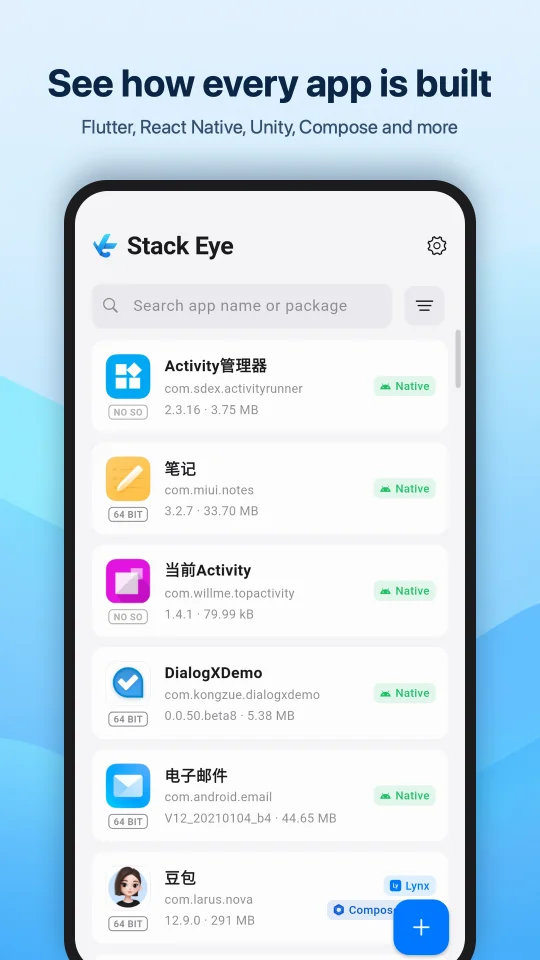
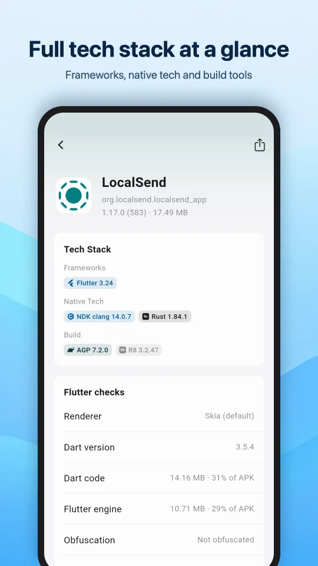
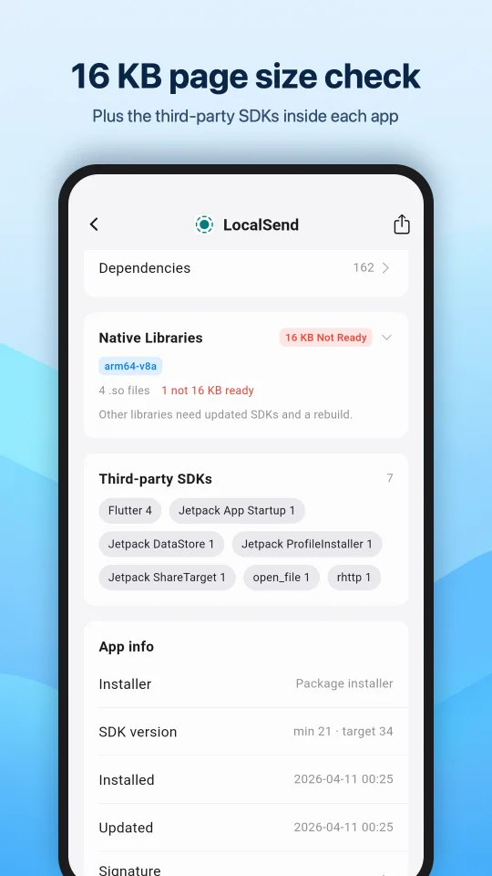
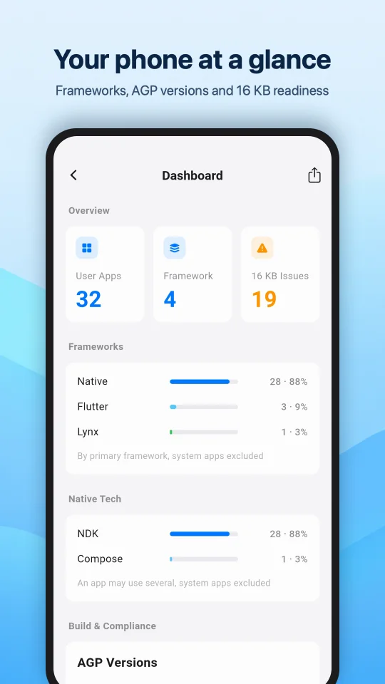
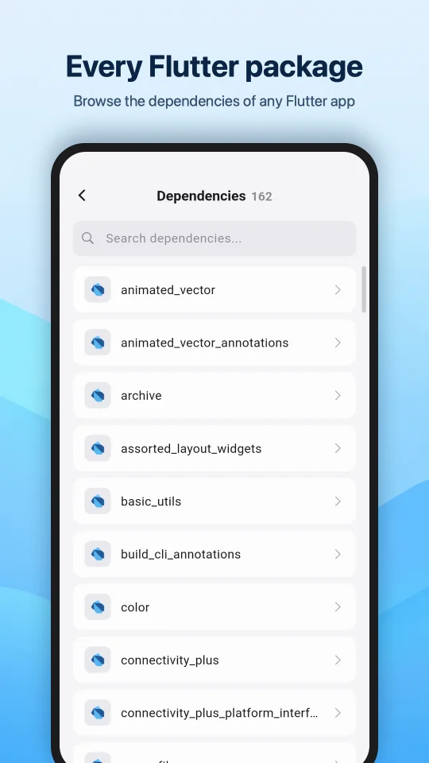
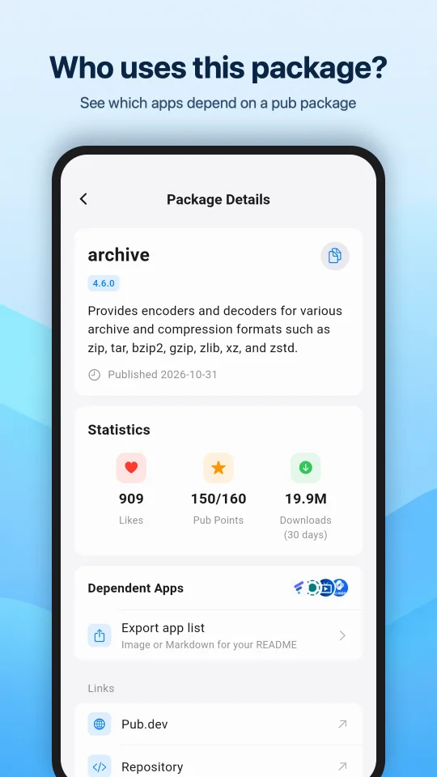
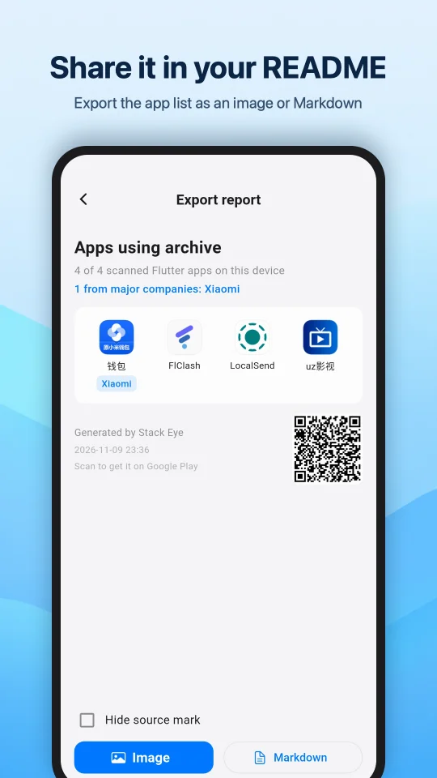

# Stack Eye

  

## 应用简介

Stack Eye（原名 FlutterEye）告诉你手机里的应用是用什么技术做的。

它会扫描所有已安装的应用，识别出用的是哪个框架：Flutter、React Native、Unity、Cocos、Unreal、Godot、Xamarin / MAUI、uni-app、Lynx、Qt、Compose Multiplatform、Cordova 等，以及 Jetpack Compose、NDK、Go、Rust 等原生技术。

分析全部在本机完成。应用已上架 Google Play 商店。

## 截图

|||||
|-|-|-|-|
|||||
|||||

## 主要功能

- **框架识别**：每个应用都标出框架和原生技术，可按框架筛选、搜索
- **16KB 页大小检查**：检查每个原生库（.so）的 ELF 段对齐和 ZIP 对齐，判断应用能否在 16KB 页设备上运行；同时显示是否带 64 位库
- **仪表盘**：所有应用的框架、原生技术、AGP 版本分布，以及 16KB 就绪比例和 64 位支持情况
- **Flutter 详情**：Flutter 与 Dart 版本、渠道、渲染引擎（Impeller / Skia）、代码混淆，以及每个应用依赖的 Flutter 包
- **依赖使用者**：查看手机里有哪些应用用了某个 Flutter 包，Google、腾讯、阿里等大厂会单独标出；可导出为图片或 Markdown，放进 README 展示
- **Cocos 详情**：Cocos Creator 与 Cocos2d-x 引擎版本
- **分析 APK 文件**：打开存储里的 .apk、.apks、.xapk，或从其他应用分享进来
- **第三方 SDK 识别**：查看每个应用集成了哪些常见的第三方 SDK
- **应用信息**：安装来源、SDK 版本、签名证书，以及屏幕适配情况（分屏、尺寸变化、方向锁定、画中画）
- **权限**：列出每个权限的保护级别：安装即授予、需用户授权、需在设置中开启、仅同签名应用、仅系统
- **四大组件**：标出 Activity、Service、Receiver、Provider 是否导出，附 intent-filter 与 adb、Kotlin、Java、Flutter 调用示例
- **导出报告**：把单个应用的报告分享为图片或 Markdown

框架识别与应用详情永久免费。Stack Eye Pro 一次买断，不是订阅：无广告、导出时可隐藏来源标识、APK 分析不限次数、全部扫描结果导出为 CSV 或 JSON。

## 下载

在 Google Play 搜索「Stack Eye」，或直接打开：https://play.google.com/store/apps/details?id=com.ailin.flutter_eye

## 问题反馈

使用中遇到识别不准或其他问题，欢迎在 [Issues](https://github.com/FullStackAction/stack_eye/issues) 反馈。

## 打赏支持

如果你觉得 Stack Eye 对你有帮助，欢迎通过以下方式支持我们的开发工作：

|[LinXunFeng](https://github.com/LinXunFeng)|[GitLqr](https://github.com/GitLqr)|
|-|-|
|||

## 关于我们

微信技术交流群请看: [【微信群说明】](https://mp.weixin.qq.com/s/JBbMstn0qW6M71hh-BRKzw)
